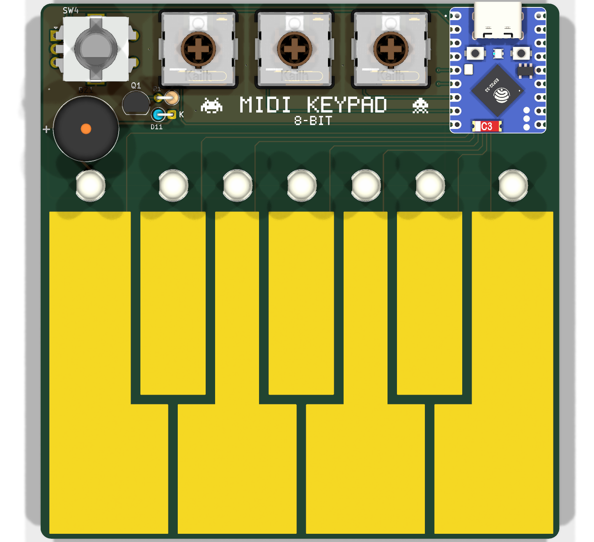
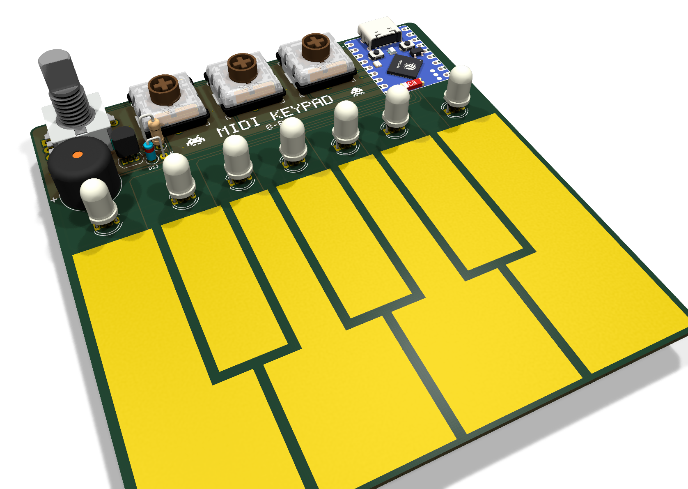
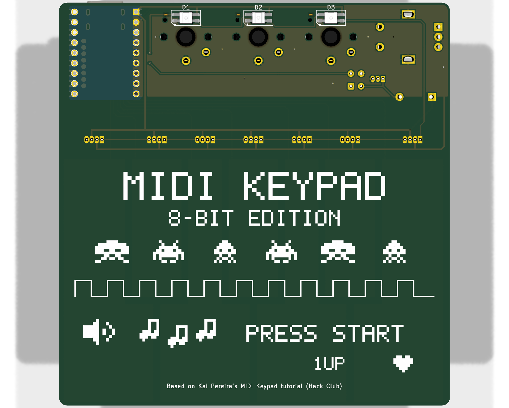

# MIDI Keypad — 8-bit edition

- **Sliders removed.** The encoder and the 3 Choc switches now share one top row, which frees a band above the keys.
- **A 5mm addressable RGB LED above each of the 7 touch keys.** They chain after the tutorial's 3 NeoPixels, so they use **no extra pins**.
- **A passive buzzer** (5V, 2048 Hz, 8 mm pin spacing), driven by a BC547 with a flyback diode.
- **Retro / chiptune pixel-art silkscreen** on both sides.

The finished project is in this folder (`MIDI-Keypad.kicad_pro`). Final checks: **ERC 0 errors / 0 warnings, DRC 0 violations / 0 unconnected** (`ERC_report.txt`, `DRC_report.txt`). Files to order with are in `production/`.

## Folder layout
- `MIDI-Keypad.*`: the finished KiCad project
- `production/`: Gerber zip for JLCPCB, BOM, positions, netlist
- `libraries/`: everything the project needs, linked relative to the project (no global KiCad setup required):
  - the tutorial's Hack Club symbols and footprints
  - this project's own symbol and footprints (`MIDI-Keypad.*`)
  - the 3D models

## Pin map (for the firmware)
| ESP32-S3-Zero pin | Function |
|---|---|
| GP2 | LED data: all 10 addressable LEDs, one chain |
| GP3 | Buzzer (PWM / tone). HIGH turns the transistor on |
| GP4 / GP5 / GP6 | SW3 / SW2 / SW1 (to GND, use internal pull-ups) |
| GP7 ... GP13 | TOUCH7 ... TOUCH1 (key 7 ... key 1, left to right is key 1 to 7) |
| TX (GPIO43) / RX (GPIO44) | Encoder A / B (to GND, use internal pull-ups) |
| GP1 | spare |

**LED chain order:**

| Index | LED | Position |
|---|---|---|
| 0 | D1 | under SW3 |
| 1 | D2 | under SW2 |
| 2 | D3 | under SW1 |
| 3-9 | D4-D10 | above keys 1-7 |

## Parts
| Ref | Qty | Part | Notes |
|---|---|---|---|
| U1 | 1 | Waveshare ESP32-S3-Zero | |
| SW1-SW3 | 3 | Kailh Choc low-profile switch | + Choc keycaps |
| SW4 | 1 | EC11 rotary encoder (vertical) | + a knob |
| D1-D3 | 3 | SK6812MINI-E | reverse-mounted on the back, shine through the board |
| D4-D10 | 7 | XINGLIGHT XL-504RGBC-WS2812B, 5mm | the Amazon.in listing B0HN43Y547. Pin 1 (DIN) is at the **flat side** |
| BZ1 | 1 | passive buzzer 5V 30mA 2048 Hz, 8 mm pitch | the Amazon.in listing B07M6517H8. "+" pin goes to the square pad |
| Q1 | 1 | BC547 (TO-92) | match the flat face to the flat side of the silkscreen outline. Collector goes on the square pad |
| R1 | 1 | 1 kΩ 1/4 W resistor | mounted standing up |
| D11 | 1 | 1N4148 | mounted standing up, **cathode (band) to the square pad** |
